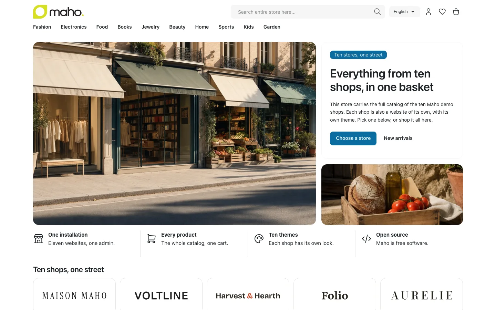
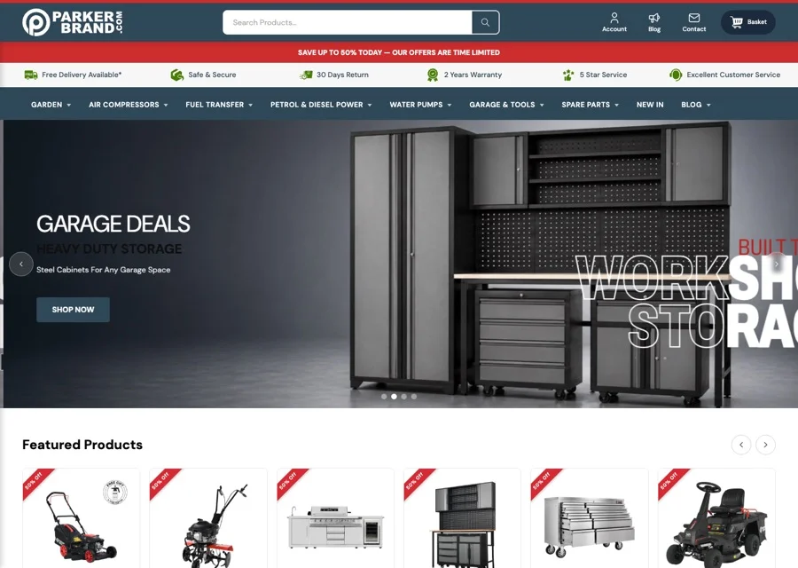
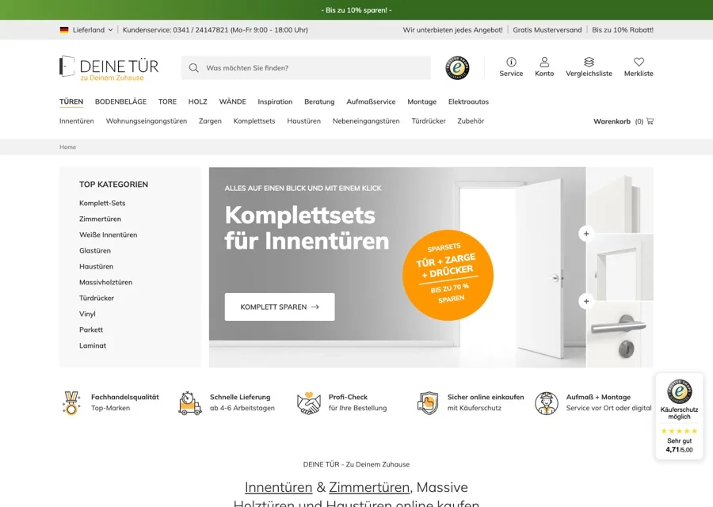
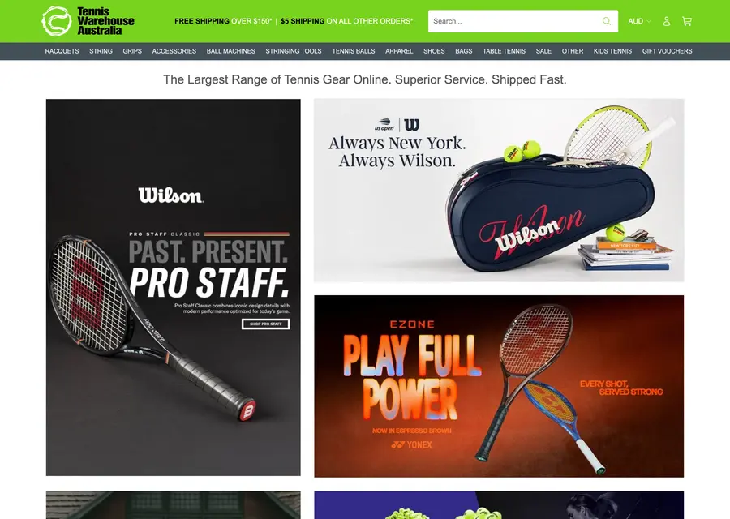
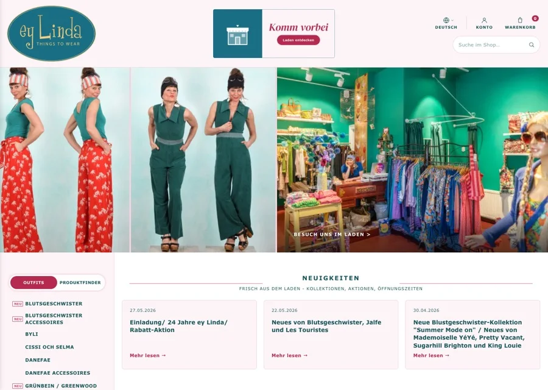

<svg width="0" height="0" focusable="false">
  <filter id="maho-duo-ink" color-interpolation-filters="sRGB">
    <feColorMatrix type="matrix" values="0.33 0.34 0.33 0 0  0.33 0.34 0.33 0 0  0.33 0.34 0.33 0 0  0 0 0 1 0"/>
    <feComponentTransfer>
      <feFuncR type="table" tableValues="0.13 0.99"/>
      <feFuncG type="table" tableValues="0.13 0.988"/>
      <feFuncB type="table" tableValues="0.12 0.97"/>
    </feComponentTransfer>
  </filter>
</svg>

<section class="mh-hero" aria-label="Maho - open-source on-premises ecommerce platform">
  

  

  

    

      <h1 id="homeh1" class="mh-headline">Maho - The heart of ecommerce,<em>the heart of your store.</em></h1>
      
The free open source ecommerce platform you actually own. Lean at the core, fully featured out of the box, and open to extend however you like. Self-hosted, with no fees skimming your margins and no vendor holding the keys.

      

        ● Open source
        ● Self-hosted
        ● Forever free
      

      

        <a class="mh-btn mh-btn-solid" href="demo/">Try the live demo
          <svg width="16" height="16" viewBox="0 0 24 24" fill="none" stroke="currentColor" stroke-width="2.5" stroke-linecap="round" stroke-linejoin="round" aria-hidden="true"><path d="M5 12h14M13 6l6 6-6 6"/></svg></a>
        <a class="mh-btn mh-btn-line" href="getting-started/">Get started</a>
        <a class="mh-btn mh-btn-ghost" href="https://discord.gg/dWgcVUFTrS">Join the community</a>
      

      

        

          
          <h3 class="mh-step-title"><button type="button" class="mh-step-button" data-step-button="0" aria-controls="mh-slides" aria-current="true">Fully featured out of the box</button></h3>
          

Most platforms sell these as paid add-ons. Maho has them in the core, from an accessibility scanner and a storefront ready for AI agents to eleven industry themes, a page builder, passkeys, product feeds and email automation.

        

        

          
          <h3 class="mh-step-title"><button type="button" class="mh-step-button" data-step-button="1" aria-controls="mh-slides">Modern stack, open to extend</button></h3>
          

PHP 8.5+, Symfony 8.1+ and Tailwind CSS 4, with no legacy JavaScript framework. REST, GraphQL and an MCP server for AI agents are in the core. Modules and events extend it without core edits.

        

        

          
          <h3 class="mh-step-title"><button type="button" class="mh-step-button" data-step-button="2" aria-controls="mh-slides">A complete toolchain</button></h3>
          

One <code>docker run</code> to try it, one <code>composer create-project</code> to start your own store. Official Docker images, the <code>maho</code> CLI, a Composer plugin and a PHPStan plugin, all made by the Maho team. No account, no signup, no meter running.

        

        

          
          <h3 class="mh-step-title"><button type="button" class="mh-step-button" data-step-button="3" aria-controls="mh-slides">100% yours</button></h3>
          

Your code, your data, your server, your keys. Open source under OSL-3.0, on any host in any country you pick. No license fee, no revenue share, and no vendor that can switch your store off.

        

      

    

    

      

        

          

          

          

        

      

      

      

      

        

          

            

            

              <svg class="mh-art" viewBox="0 0 480 240" fill="none" stroke-linecap="round" stroke-linejoin="round" aria-hidden="true">
                <g transform="translate(240 120) scale(1.1) translate(-240 -120)">
                  <circle cx="240" cy="120" r="100" class="orbit"/>
                  <g class="st">
                    <path d="M204 104l8-16h56l8 16z"/>
                    <path d="M204 104a9 9 0 0 0 18 0a9 9 0 0 0 18 0a9 9 0 0 0 18 0a9 9 0 0 0 18 0"/>
                    <path d="M210 113v41h60v-41"/>
                  </g>
                  <path d="M232 154v-22h16v22" class="acc"/>
                  <g class="node"><circle cx="201" cy="28" r="16"/><path d="M199 22a2 2 0 1 0 4 0a2 2 0 1 0-4 0M194 26h14M201 26v5l-4 5M201 31l4 5" class="acc"/></g>
                  <text x="177" y="25" class="lb ft" text-anchor="end"><tspan>Accessibility</tspan><tspan x="177" dy="16">scanner</tspan></text>
                  <g class="node"><circle cx="151" cy="74" r="16"/><path d="M152 67h5v14h-5M143 74h10M149 70l4 4-4 4" class="acc"/></g>
                  <text x="127" y="79" class="lb ft" text-anchor="end">Social login</text>
                  <g class="node"><circle cx="140" cy="120" r="16"/><path d="M132 120a3.5 3.5 0 1 0 7 0a3.5 3.5 0 1 0-7 0M139 120h9M144 120v3M147 120v3" class="acc"/></g>
                  <text x="116" y="117" class="lb ft" text-anchor="end"><tspan>Passkeys</tspan><tspan x="116" dy="16">and 2FA</tspan></text>
                  <g class="node"><circle cx="151" cy="166" r="16"/><path d="M143 158h7l9 9-7 7-9-9zM146.5 161.5h.01" class="acc"/></g>
                  <text x="127" y="163" class="lb ft" text-anchor="end"><tspan>Dynamic</tspan><tspan x="127" dy="16">categories</tspan></text>
                  <g class="node"><circle cx="201" cy="212" r="16"/><path d="M191 206h20v13h-20zM191 206l10 7 10-7" class="acc"/></g>
                  <text x="177" y="209" class="lb ft" text-anchor="end"><tspan>Email</tspan><tspan x="177" dy="16">automation</tspan></text>
                  <g class="node"><circle cx="279" cy="28" r="16"/><path d="M271 24h16v12h-16zM279 24v-3M279 19.5h.01M275 29.5h2M281 29.5h2M276 33h6" class="acc"/></g>
                  <text x="303" y="25" class="lb ft"><tspan>Agent-ready</tspan><tspan x="303" dy="16">storefront</tspan></text>
                  <g class="node"><circle cx="329" cy="74" r="16"/><path d="M320 69h18v12h-18zM326 69v12M320 74h18" class="acc"/></g>
                  <text x="353" y="79" class="lb ft">Gift cards</text>
                  <g class="node"><circle cx="340" cy="120" r="16"/><path d="M334 126h.01M334 119a7 7 0 0 1 7 7M334 113a13 13 0 0 1 13 13" class="acc"/></g>
                  <text x="364" y="125" class="lb ft">Product feeds</text>
                  <g class="node"><circle cx="329" cy="166" r="16"/><path d="M320 158h18v5h-18zM320 166h8v8h-8zM330 166h8v8h-8z" class="acc"/></g>
                  <text x="353" y="171" class="lb ft">Page builder</text>
                  <g class="node"><circle cx="279" cy="212" r="16"/><path d="M272 207a3 3 0 1 0 6 0a3 3 0 1 0-6 0M280 207a3 3 0 1 0 6 0a3 3 0 1 0-6 0M269 220a6 6 0 0 1 12 0M277 220a6 6 0 0 1 12 0" class="acc"/></g>
                  <text x="303" y="209" class="lb ft"><tspan>Customer</tspan><tspan x="303" dy="16">segments</tspan></text>
                </g>
              </svg>
            

            

              <svg class="mh-art" viewBox="0 0 480 240" fill="none" stroke-linecap="round" stroke-linejoin="round" aria-hidden="true">
                <g class="st">
                  <rect x="12" y="28" width="150" height="40" rx="8"/>
                  <rect x="12" y="100" width="150" height="40" rx="8"/>
                  <rect x="12" y="172" width="150" height="40" rx="8"/>
                </g>
                <text x="28" y="54" class="lb lg">PHP 8.5+</text>
                <text x="28" y="126" class="lb lg">Symfony 8.1+</text>
                <text x="28" y="198" class="lb lg">Tailwind CSS 4</text>
                <path class="flow" d="M166 48l26 52M166 120h26M166 192l26-52"/>
                <rect x="196" y="88" width="88" height="64" rx="12" class="acc-fill"/>
                <text x="240" y="125" class="lb lg on-acc" text-anchor="middle">Maho core</text>
                <path class="flow" d="M288 100l26-52M288 120h26M288 140l26 52"/>
                <g class="st">
                  <rect x="318" y="28" width="150" height="40" rx="8"/>
                  <rect x="318" y="100" width="150" height="40" rx="8"/>
                  <rect x="318" y="172" width="150" height="40" rx="8"/>
                </g>
                <text x="334" y="54" class="lb lg">REST API</text>
                <text x="334" y="126" class="lb lg">GraphQL API</text>
                <text x="334" y="198" class="lb lg acc-t">MCP server</text>
              </svg>
            

            

              <svg class="mh-art" viewBox="0 0 480 240" fill="none" stroke-linecap="round" stroke-linejoin="round" aria-hidden="true">
                <rect x="12" y="10" width="456" height="34" rx="7" class="st"/>
                <text x="26" y="32" class="lb mono cmd"><tspan class="acc-t">$</tspan> docker run -p 54321:443 <tspan class="img">mahocommerce/maho:nightly</tspan></text>
                <g class="st">
                  <rect x="12" y="56" width="148" height="84" rx="9"/>
                  <rect x="166" y="56" width="148" height="84" rx="9"/>
                  <rect x="320" y="56" width="148" height="84" rx="9"/>
                  <rect x="12" y="150" width="148" height="84" rx="9"/>
                  <rect x="166" y="150" width="148" height="84" rx="9"/>
                  <rect x="320" y="150" width="148" height="84" rx="9"/>
                </g>
                <g class="node"><circle cx="42" cy="82" r="16"/><path d="M34 78l8-4 8 4v9l-8 4-8-4zM34 78l8 4 8-4M42 82v9" class="acc"/></g>
                <text x="26" y="118" class="lb ft">Docker images</text>
                <text x="26" y="133" class="lb mono">FrankenPHP, HTTP/3</text>
                <g class="node"><circle cx="196" cy="82" r="16"/><path d="M187 75h18v14h-18zM191 80l3 2-3 2M197 85h4" class="acc"/></g>
                <text x="180" y="118" class="lb ft">maho CLI</text>
                <text x="180" y="133" class="lb mono">install, build, run</text>
                <g class="node"><circle cx="350" cy="82" r="16"/><path d="M341 76h6l2 2h10v11h-18z" class="acc"/></g>
                <text x="334" y="118" class="lb ft">Starter project</text>
                <text x="334" y="133" class="lb mono">maho-starter</text>
                <g class="node"><circle cx="42" cy="176" r="16"/><path d="M34 175a6 6 0 1 0 12 0a6 6 0 1 0-12 0M44.5 179.5l5 5M37 175l2 2 3.5-3.5" class="acc"/></g>
                <text x="26" y="212" class="lb ft" textLength="124" lengthAdjust="spacingAndGlyphs">Composer&thinsp;+&thinsp;PHPStan</text>
                <text x="26" y="227" class="lb mono">official plugins</text>
                <g class="node"><circle cx="196" cy="176" r="16"/><path d="M189 176a7 7 0 1 0 14 0a7 7 0 1 0-14 0" class="acc"/><path d="M196 169a7 7 0 0 0 0 14z" class="acc-fill"/></g>
                <text x="180" y="212" class="lb ft">Theme tooling</text>
                <text x="180" y="227" class="lb mono">Tailwind, tokens</text>
                <g class="node"><circle cx="350" cy="176" r="16"/><path d="M350 168l7 3v5c0 5-3 8-7 9-4-1-7-4-7-9v-5zM347 176.5l2 2 4-4" class="acc"/></g>
                <text x="334" y="212" class="lb ft">SBOMs&thinsp;+&thinsp;SLSA L3</text>
                <text x="334" y="227" class="lb mono">scanned every day</text>
              </svg>
            

            

              <svg class="mh-art" viewBox="0 0 480 240" fill="none" stroke-linecap="round" stroke-linejoin="round" aria-hidden="true">
                <g class="node"><circle cx="36" cy="36" r="16"/><path d="M31 30l-5 6 5 6M41 30l5 6-5 6M38 28l-4 16" class="acc"/></g>
                <text x="62" y="34" class="lb ft">Your code</text>
                <text x="62" y="50" class="lb mono">fork it, OSL-3.0</text>
                <g class="node"><circle cx="36" cy="88" r="16"/><path d="M28 82a8 3 0 1 0 16 0a8 3 0 1 0-16 0M28 82v12a8 3 0 0 0 16 0v-12M28 88a8 3 0 0 0 16 0" class="acc"/></g>
                <text x="62" y="86" class="lb ft">Your data</text>
                <text x="62" y="102" class="lb mono">stays where you put it</text>
                <g class="node"><circle cx="36" cy="140" r="16"/><path d="M28 132h16v7h-16zM28 141h16v7h-16zM40 135.5h.01M40 144.5h.01" class="acc"/></g>
                <text x="62" y="138" class="lb ft">Your server</text>
                <text x="62" y="154" class="lb mono">any host, any country</text>
                <g class="node"><circle cx="36" cy="192" r="16"/><path d="M28 192a3.5 3.5 0 1 0 7 0a3.5 3.5 0 1 0-7 0M35 192h9M40 192v3M43 192v3" class="acc"/></g>
                <text x="62" y="190" class="lb ft">Your keys</text>
                <text x="62" y="206" class="lb mono">no one can shut you down</text>
                <path class="flow" d="M226 114h36"/>
                <path d="M272 30h184v170l-11.5 8l-11.5-8l-11.5 8l-11.5-8l-11.5 8l-11.5-8l-11.5 8l-11.5-8l-11.5 8l-11.5-8l-11.5 8l-11.5-8l-11.5 8l-11.5-8l-11.5 8l-11.5-8z" class="st"/>
                <text x="364" y="54" class="lb sm" text-anchor="middle">Your Maho bill</text>
                <path d="M286 66h156M286 162h156" class="st"/>
                <text x="286" y="92" class="lb mono ft">license fee</text>
                <text x="442" y="92" class="lb ft acc-t" text-anchor="end">€0</text>
                <text x="286" y="118" class="lb mono ft">revenue share</text>
                <text x="442" y="118" class="lb ft acc-t" text-anchor="end">0%</text>
                <text x="286" y="144" class="lb mono ft">vendor lock-in</text>
                <text x="442" y="144" class="lb ft acc-t" text-anchor="end">none</text>
                <text x="286" y="187" class="lb ft">total</text>
                <text x="442" y="188" class="lb tot acc-t" text-anchor="end">€0</text>
              </svg>
            

            

              <button class="mh-motion-btn mh-motion-btn-dark" id="mh-slides-pause" type="button" aria-label="Pause the slides" title="Pause the slides" hidden>
                <svg class="mh-ico-pause" viewBox="0 0 24 24" width="15" height="15" fill="none" stroke="currentColor" stroke-width="2.2" stroke-linecap="round" aria-hidden="true"><path d="M9 5v14M15 5v14"/></svg>
                <svg class="mh-ico-play" viewBox="0 0 24 24" width="15" height="15" fill="none" stroke="currentColor" stroke-width="2.2" stroke-linecap="round" stroke-linejoin="round" aria-hidden="true"><path d="M8 4.8l11 7.2-11 7.2z"/></svg>
              </button>
            

          

        

      

    

  

  
Scroll

  

  

  

    

      <h2 class="mh-sec-title">10 + 1 professionally curated, industry-focused themes</h2>
    

    

      

        
        

          <a class="mh-tab is-active" role="tab" aria-selected="true" data-mode="store" href="about/themes/">
            <svg width="14" height="14" viewBox="0 0 24 24" fill="none" stroke="currentColor" stroke-width="2" stroke-linecap="round" stroke-linejoin="round" aria-hidden="true"><path d="M3 9 4.5 4h15L21 9M4 9v10a1 1 0 0 0 1 1h14a1 1 0 0 0 1-1V9M4 9h16M9 13a3 3 0 0 0 6 0"/></svg>
            Storefront</a>
          <a class="mh-tab" role="tab" aria-selected="false" data-mode="admin" href="demo/">
            <svg width="14" height="14" viewBox="0 0 24 24" fill="none" stroke="currentColor" stroke-width="2" stroke-linecap="round" stroke-linejoin="round" aria-hidden="true"><rect x="3" y="3" width="18" height="18" rx="2"/><path d="M3 9h18M9 21V9"/></svg>
            Admin</a>
        

        Default · Home
        

          Try dark mode →
          <button class="mh-bulb" type="button" aria-pressed="false" aria-label="Switch the screenshot to dark mode" title="Toggle light / dark" data-mh-js hidden>
            <svg viewBox="0 0 24 24" width="16" height="16" fill="none" stroke="currentColor" stroke-width="1.8" stroke-linecap="round" stroke-linejoin="round" aria-hidden="true">
              <path d="M9 18h6"/><path d="M10 21h4"/>
              <path d="M12 3a6 6 0 0 0-4 10.5c.7.7 1 1.2 1 2.5h6c0-1.3.3-1.8 1-2.5A6 6 0 0 0 12 3z"/>
            </svg>
          </button>
          <button class="mh-full" type="button" aria-label="Fill the browser window" title="Fill the browser window" data-mh-js hidden>
            <svg class="mh-full-open" viewBox="0 0 24 24" width="15" height="15" fill="none" stroke="currentColor" stroke-width="2" stroke-linecap="round" stroke-linejoin="round" aria-hidden="true"><path d="M8 3H5a2 2 0 0 0-2 2v3M21 8V5a2 2 0 0 0-2-2h-3M3 16v3a2 2 0 0 0 2 2h3M16 21h3a2 2 0 0 0 2-2v-3"/></svg>
            <svg class="mh-full-close" viewBox="0 0 24 24" width="15" height="15" fill="none" stroke="currentColor" stroke-width="2" stroke-linecap="round" stroke-linejoin="round" aria-hidden="true"><path d="M8 3v3a2 2 0 0 1-2 2H3M21 8h-3a2 2 0 0 1-2-2V3M3 16h3a2 2 0 0 1 2 2v3M16 21v-3a2 2 0 0 1 2-2h3"/></svg>
          </button>
        

      

      

        <a class="mh-tstage-pick" href="about/themes/#theme-default" data-theme="default" data-name="Default">Default</a>
        <a class="mh-tstage-pick" href="about/themes/#theme-fashion" data-theme="fashion" data-name="Fashion">Fashion</a>
        <a class="mh-tstage-pick" href="about/themes/#theme-beauty" data-theme="beauty" data-name="Beauty">Beauty</a>
        <a class="mh-tstage-pick" href="about/themes/#theme-sports" data-theme="sports" data-name="Sports">Sports</a>
        <a class="mh-tstage-pick" href="about/themes/#theme-kids" data-theme="kids" data-name="Kids" data-dark="no">Kids</a>
        <a class="mh-tstage-pick" href="about/themes/#theme-electronics" data-theme="electronics" data-name="Electronics">Electronics</a>
        <a class="mh-tstage-pick" href="about/themes/#theme-food" data-theme="food" data-name="Food" data-dark="no">Food</a>
        <a class="mh-tstage-pick" href="about/themes/#theme-books" data-theme="books" data-name="Books">Books</a>
        <a class="mh-tstage-pick" href="about/themes/#theme-jewelry" data-theme="jewelry" data-name="Jewelry">Jewelry</a>
        <a class="mh-tstage-pick" href="about/themes/#theme-home" data-theme="home" data-name="Home">Home</a>
        <a class="mh-tstage-pick" href="about/themes/#theme-garden" data-theme="garden" data-name="Garden">Garden</a>
      

      

        <button class="mh-tstage-pick" type="button" data-light="assets/admin-screens/dashboard-light.webp" data-dark="assets/admin-screens/dashboard-dark.webp" data-title="Dashboard">Dashboard</button>
        <button class="mh-tstage-pick" type="button" data-light="assets/admin-screens/products-grid-light.webp" data-dark="assets/admin-screens/products-grid-dark.webp" data-title="Products grid">Products grid</button>
        <button class="mh-tstage-pick" type="button" data-light="assets/admin-screens/product-edit-light.webp" data-dark="assets/admin-screens/product-edit-dark.webp" data-title="Product edit">Product edit</button>
        <button class="mh-tstage-pick" type="button" data-light="assets/admin-screens/system-config-light.webp" data-dark="assets/admin-screens/system-config-dark.webp" data-title="System config">System config</button>
        <button class="mh-tstage-pick" type="button" data-light="assets/admin-screens/cms-editor-light.webp" data-dark="assets/admin-screens/cms-editor-dark.webp" data-title="CMS editor">CMS editor</button>
        <button class="mh-tstage-pick" type="button" data-light="assets/admin-screens/page-builder-light.webp" data-dark="assets/admin-screens/page-builder-dark.webp" data-title="Page builder">Page builder</button>
        <button class="mh-tstage-pick" type="button" data-light="assets/admin-screens/category-tree-light.webp" data-dark="assets/admin-screens/category-tree-dark.webp" data-title="Category tree">Category tree</button>
        <button class="mh-tstage-pick" type="button" data-light="assets/admin-screens/navigation-light.webp" data-dark="assets/admin-screens/navigation-dark.webp" data-title="Navigation">Navigation</button>
        <button class="mh-tstage-pick" type="button" data-light="assets/admin-screens/health-check-light.webp" data-dark="assets/admin-screens/health-check-dark.webp" data-title="Health check">Health check</button>
        <button class="mh-tstage-pick" type="button" data-light="assets/admin-screens/cache-management-light.webp" data-dark="assets/admin-screens/cache-management-dark.webp" data-title="Cache management">Cache management</button>
      

      

        

          
        

        <button class="mh-shot-nav mh-shot-prev" type="button" aria-label="Previous" data-mh-js hidden>
          <svg viewBox="0 0 24 24" width="30" height="30" fill="none" stroke="currentColor" stroke-width="2.4" stroke-linecap="round" stroke-linejoin="round" aria-hidden="true"><path d="M15 6l-6 6 6 6"/></svg>
        </button>
        <button class="mh-shot-nav mh-shot-next" type="button" aria-label="Next" data-mh-js hidden>
          <svg viewBox="0 0 24 24" width="30" height="30" fill="none" stroke="currentColor" stroke-width="2.4" stroke-linecap="round" stroke-linejoin="round" aria-hidden="true"><path d="M9 6l6 6-6 6"/></svg>
        </button>
        

      

    

    
<a class="mh-btn mh-btn-line" href="about/themes/">Compare all eleven themes <svg width="16" height="16" viewBox="0 0 24 24" fill="none" stroke="currentColor" stroke-width="2.5" stroke-linecap="round" stroke-linejoin="round" aria-hidden="true"><path d="M5 12h14M13 6l6 6-6 6"/></svg></a>

    
<a class="mh-btn mh-btn-line" href="demo/">Try it in the live demo <svg width="16" height="16" viewBox="0 0 24 24" fill="none" stroke="currentColor" stroke-width="2.5" stroke-linecap="round" stroke-linejoin="round" aria-hidden="true"><path d="M5 12h14M13 6l6 6-6 6"/></svg></a>

  

</section>

<section class="mh-agents" aria-label="Maho is ready for agentic commerce">
  

    

      <h2 class="mh-sec-title">Ready for agentic commerce</h2>
      
More and more of your traffic is an AI agent shopping on someone's behalf. Maho answers it with clean facts, gives you control over which agents get in, and lets your own agents run the store.

      <ul class="mh-agents-points">
        <li>
          <svg viewBox="0 0 24 24" width="20" height="20" fill="none" stroke="currentColor" stroke-width="2" stroke-linecap="round" stroke-linejoin="round"><path d="M14 3v4a1 1 0 0 0 1 1h4"/><path d="M17 21H7a2 2 0 0 1-2-2V5a2 2 0 0 1 2-2h7l5 5v11a2 2 0 0 1-2 2z"/><path d="M9 13h6M9 17h6"/></svg>
          <strong>Every page in markdown, on the same URL.</strong> A product answers with name, SKU, price, stock and options. A category answers with a product table. No navigation, no scripts, no guessing where the price is.
        </li>
        <li>
          <svg viewBox="0 0 24 24" width="20" height="20" fill="none" stroke="currentColor" stroke-width="2" stroke-linecap="round" stroke-linejoin="round"><path d="M12 3l8 4v5c0 5-3.5 8.5-8 9-4.5-.5-8-4-8-9V7z"/><path d="M9 12l2 2 4-4"/></svg>
          <strong>llms.txt and robots.txt, generated per store.</strong> Agents find your pages, categories and search. You decide which AI crawlers get in, grouped by purpose, so you can stay in AI answers and still block training bots.
        </li>
        <li>
          <svg viewBox="0 0 24 24" width="20" height="20" fill="none" stroke="currentColor" stroke-width="2" stroke-linecap="round" stroke-linejoin="round"><rect x="4" y="8" width="16" height="12" rx="2"/><path d="M12 4v4M8 2h8M9 14h.01M15 14h.01"/></svg>
          <strong>An MCP server for your own agents.</strong> Paste the store URL into Claude, ChatGPT or any MCP client, log in to your admin, and the agent works with the store under the same permissions as the REST API.
        </li>
      </ul>
      

        <a class="mh-btn mh-btn-solid" href="user-guide/ai-and-crawlers/">AI agents guide
          <svg width="16" height="16" viewBox="0 0 24 24" fill="none" stroke="currentColor" stroke-width="2.5" stroke-linecap="round" stroke-linejoin="round" aria-hidden="true"><path d="M5 12h14M13 6l6 6-6 6"/></svg></a>
        <a class="mh-btn mh-btn-line" href="api/v2/mcp/">MCP server docs</a>
      

    

    

      

        

          

            
            agent@anywhere
          

          

            
# the same product URL, asked as an agent

            
$ curl -H "Accept: text/markdown" https://demo.mahocommerce.com/meridian-slip-dress/

            
# Meridian slip dress

            
- SKU: W-SLIP-DRESS

            
- Price: $119.00

            
- Availability: In stock

            
## Options

            
| Color  | SKU                 | Price   | Availability |

            
|--------|---------------------|---------|--------------|

            
| Black  | W-SLIP-DRESS-BLACK  | $119.00 | In stock     |

            
| Salmon | W-SLIP-DRESS-SALMON | $119.00 | In stock     |

          

        

      

      
Real output from the <a href="https://demo.mahocommerce.com/default/meridian-slip-dress.md" target="_blank" rel="noopener">demo store</a>. Browsers and search engines keep the HTML page.

    

  

</section>

<section class="mh-funding" aria-label="Maho is backed by European public funding, partners and sponsors">
  

    <h2 class="mh-sec-title">Funded by the European Commission</h2>
    
This project is funded through the <a href="https://nlnet.nl/taler" target="_blank" rel="noopener">NGI TALER Fund</a>, a fund established by <a href="https://nlnet.nl" target="_blank" rel="noopener">NLnet</a> with financial support from the European Commission's <a href="https://ngi.eu" target="_blank" rel="noopener">Next Generation Internet</a> program. Learn more at the <a href="https://nlnet.nl/project/Maho" target="_blank" rel="noopener">NLnet project page</a>.

    

      
      
    

  

  

    

      
Together with our sponsors and partners

      <button class="mh-motion-btn mh-marquee-pause" id="mh-marquee-pause" type="button" aria-label="Pause the scrolling sponsor logos" title="Pause the scrolling sponsor logos">
        <svg class="mh-ico-pause" viewBox="0 0 24 24" width="15" height="15" fill="none" stroke="currentColor" stroke-width="2.2" stroke-linecap="round" aria-hidden="true"><path d="M9 5v14M15 5v14"/></svg>
        <svg class="mh-ico-play" viewBox="0 0 24 24" width="15" height="15" fill="none" stroke="currentColor" stroke-width="2.2" stroke-linecap="round" stroke-linejoin="round" aria-hidden="true"><path d="M8 4.8l11 7.2-11 7.2z"/></svg>
      </button>
    

    <a class="mh-marquee-link" href="sponsors/" title="Meet the partners and sponsors behind Maho">
      

        

          

            
            
            
            
            
            
            
            
          

          

            
            
            
            
            
            
            
            
          

        

      

    </a>
  

</section>

<section class="mh-stores" aria-label="Real stores running Maho">
  

    

      <h2 class="mh-sec-title">Selling on Maho right now</h2>
      
Worldwide merchants run their storefronts on Maho.

    

    

      <button class="mh-stores-arrow mh-stores-prev" type="button" aria-label="Previous stores">
        <svg viewBox="0 0 24 24" width="26" height="26" fill="none" stroke="currentColor" stroke-width="2.4" stroke-linecap="round" stroke-linejoin="round" aria-hidden="true"><path d="M15 6l-6 6 6 6"/></svg>
      </button>
      

        

          <a class="mh-store-card" href="https://www.parkerbrand.co.uk" target="_blank" rel="noopener">
            
            
              ParkerBrand
              🇬🇧 United Kingdom · Garden &amp; workshop
            
          </a>
          <a class="mh-store-card" href="https://www.deinetuer.de" target="_blank" rel="noopener">
            
            
              Deine Tür
              🇪🇺 Europe-wide · Doors &amp; interiors
            
          </a>
          <a class="mh-store-card" href="https://www.mooremilitaria.com" target="_blank" rel="noopener">
            
            
              Moore Militaria
              🇺🇸 United States · Militaria &amp; collectibles
            
          </a>
          <a class="mh-store-card" href="https://www.tenniswarehouse.com.au" target="_blank" rel="noopener">
            
            
              Tennis Warehouse Australia
              🇦🇺 Australia · Tennis gear &amp; apparel
            
          </a>
          <a class="mh-store-card" href="https://www.eylinda.de" target="_blank" rel="noopener">
            
            
              ey Linda
              🇩🇪 Germany · Fashion &amp; apparel
            
          </a>
        

      

      <button class="mh-stores-arrow mh-stores-next" type="button" aria-label="More stores">
        <svg viewBox="0 0 24 24" width="26" height="26" fill="none" stroke="currentColor" stroke-width="2.4" stroke-linecap="round" stroke-linejoin="round" aria-hidden="true"><path d="M9 6l6 6-6 6"/></svg>
      </button>
    

    

      <a class="mh-btn mh-btn-line" href="https://trends.builtwith.com/shop/MahoCommerce" target="_blank" rel="noopener">And the list keeps growing</a>
      
      Is your store running on Maho?
      <a class="mh-btn mh-btn-solid" href="mailto:info@mahocommerce.com?subject=Add%20my%20store%20to%20mahocommerce.com&amp;body=Store%20name%3A%0AStore%20URL%3A%0ACountry%3A%0AWhat%20you%20sell%3A%0A%0AHappy%20for%20Maho%20to%20feature%20my%20store%3A%20yes">Showcase it here
        <svg width="15" height="15" viewBox="0 0 24 24" fill="none" stroke="currentColor" stroke-width="2.5" stroke-linecap="round" stroke-linejoin="round" aria-hidden="true"><path d="M5 12h14M13 6l6 6-6 6"/></svg></a>
    

    

      

        Whoever you are, Maho is for you
        

          <a class="mh-audience-pill" href="#for-store-owners">
          <svg class="mh-pill-icon" width="18" height="18" viewBox="0 0 24 24" fill="none" stroke="currentColor" stroke-width="2" stroke-linecap="round" stroke-linejoin="round" aria-hidden="true"><path d="M3 9 4.5 4h15L21 9M4 9v10a1 1 0 0 0 1 1h14a1 1 0 0 0 1-1V9M4 9h16M9 13a3 3 0 0 0 6 0"/></svg>
          Store owners
        </a>
        <a class="mh-audience-pill" href="#for-agencies">
          <svg class="mh-pill-icon" width="18" height="18" viewBox="0 0 24 24" fill="none" stroke="currentColor" stroke-width="2" stroke-linecap="round" stroke-linejoin="round" aria-hidden="true"><rect x="2" y="7" width="20" height="14" rx="2"/><path d="M16 21V5a2 2 0 0 0-2-2h-4a2 2 0 0 0-2 2v16"/></svg>
          Agencies
        </a>
        <a class="mh-audience-pill" href="#for-developers">
          <svg class="mh-pill-icon" width="18" height="18" viewBox="0 0 24 24" fill="none" stroke="currentColor" stroke-width="2" stroke-linecap="round" stroke-linejoin="round" aria-hidden="true"><path d="m16 18 6-6-6-6M8 6l-6 6 6 6"/></svg>
          Developers
        </a>
        

      

    

  

</section>

<h2 class="mh-sec-title">For store owners</h2>

Run your store with enterprise features that actually help you sell more, without the enterprise price tag or complexity.

:material-auto-fix:{ .feature-icon }

### Smart Automation That Saves Time

Create **rule-based customer segments** and **dynamic categories** that update **automatically**. Target the right customers with personalized campaigns while products organize themselves based on rules you define. Spend less time on manual work, more time growing.

:material-email-multiple:{ .feature-icon }

### Email Automation That Works While You Sleep

Build **multi-step email campaigns** that trigger automatically based on customer behavior. Send **personalized coupon codes**, nurture leads, and re-engage customers with **customizable delays** between messages. **GDPR-compliant** tracking ensures you stay on the right side of privacy laws.

:material-bullhorn:{ .feature-icon }

### Marketing Tools Built Right In

Integrated **blog module** for content marketing and SEO, **Meta Pixel** for conversion tracking, professional **SMTP** email sending, and advanced **payment method restrictions**. Everything you need to market and sell strategically, **no third-party plugins** required.

:material-account-key:{ .feature-icon }

### Social Login

Let customers sign in with **Google, Apple and Facebook** in one tap. Existing accounts are **linked automatically**, guest carts are merged, and 2FA still applies. Fewer forms means **fewer abandoned carts**.

:material-shopping:{ .feature-icon }

### Checkout That Converts

Modern **minimal checkout layout**, **offcanvas navigation**, and blazing-fast **autocomplete search** create a smooth shopping experience. Fast page loads mean happy customers and **better conversion rates**.

:material-image-edit:{ .feature-icon }

### Professional Content Creation

**Edit and optimize product images** directly in the **media library**. Create beautiful product descriptions, CMS pages, and **engaging slideshows** with the modern **TipTap editor** - intuitive, powerful, and **no external tools** needed.

:material-human-handsup:{ .feature-icon }

### Accessibility Scanner Built In

Run **WCAG audits** straight from the admin with the built-in **accessibility scanner**. Every violation is **outlined on a screenshot** of your page, desktop and mobile, and mapped to the template that caused it. **Scheduled scans** and **PDF export** keep you compliant where accessibility is required by law.

:material-shield-check:{ .feature-icon }

### Enterprise-Level Security

Protect your business with **2-factor authentication**, **passkey support** for backend login, **admin activity logging**, **GDPR-compliant captcha**, and modern **libsodium encryption**. Sleep well knowing your store is secure.

:material-rocket-launch:{ .feature-icon }

### Always Getting Better

Regular updates with real improvements like a **brand-new storefront with eleven themes** (26.9), **social login** (26.9), the **accessibility scanner** (26.9), a **redesigned admin with dark mode** (26.7), **gift cards** (26.1), and **email automation** (25.11). Maho evolves with your business needs.

<h2 class="mh-sec-title">For agencies</h2>

Deliver professional ecommerce solutions to clients with a platform that's proven, powerful, and cost-effective.

:material-monitor-dashboard:{ .feature-icon }

### Client-Ready Platform

Clean, modern **admin interface** with professional features clients expect: **media management**, **content editor**, **activity logs**, and comprehensive reporting. Built-in **blog and marketing tools** mean you deliver more value out of the box.

:material-cash-multiple:{ .feature-icon }

### Enterprise Features, Zero Licensing

**Multi-store capabilities**, advanced permissions, comprehensive **APIs** (REST, GraphQL, SOAP, MCP), and all the features enterprise clients demand. **No per-client licensing fees**, **no SaaS subscriptions** - pure profit margin.

:material-account-group:{ .feature-icon }

### Independent, Not Isolated

Maho stands on a **[battle-tested open-source foundation](about/origins.md)**, hardened by real stores running in production. **Active development**, **API documentation and developer guides**, **[AI-powered code documentation](https://deepwiki.com/MahoCommerce/maho){:target="_blank"}** via DeepWiki, and **direct access to the maintainers** mean you're never stuck.

<h2 class="mh-sec-title">For developers</h2>

Build with a modern tech stack and clean architecture, no legacy baggage, just great developer experience.

:material-language-php:{ .feature-icon }

### Modern Tech Stack

**PHP 8.5+** built on industry-standard libraries: **Doctrine DBAL 4.4** for database operations, **Symfony HttpClient** for HTTP requests, **Symfony Validator** for data validation, **Symfony Messenger** for background jobs, and **Monolog** for logging. A storefront and an admin on **Tailwind CSS 4 and daisyUI 5**, **vanilla JavaScript only** throughout. Contemporary, actively-maintained dependencies you can trust.

:material-layers:{ .feature-icon }

### Clean Architecture

Well-designed **MVC pattern**, powerful **ORM with collections**, **event-driven system**, and **modular architecture**. Code that makes sense, patterns you recognize, structure you can extend confidently.

:material-api:{ .feature-icon }

### Comprehensive APIs

Brand-new **REST & GraphQL API** built on API Platform, with **JWT authentication**, granular per-resource permissions, and **OpenAPI docs**, plus the legacy SOAP and XML-RPC APIs for older integrations.

:material-database:{ .feature-icon }

### Multi-Database Support

Choose the database that fits your infrastructure. **MySQL**, **MariaDB**, **PostgreSQL**, and **SQLite** are all supported through **Doctrine DBAL**, with automatic SQL dialect handling. Your code works across all engines without modification.

:material-update:{ .feature-icon }

### Actively Developed

**Regular releases** with substantial improvements - not just patches. Recent additions: a **Tailwind CSS 4 storefront**, an **MCP server**, a **native job queue**, **OpenTelemetry** observability, a **declarative database schema** system, the **API Platform-based REST & GraphQL API**, and the **Doctrine DBAL** database layer. Continuous modernization with real features that matter.

:material-puzzle-outline:{ .feature-icon }

### Extensible by Design

**Module system** for clean extensions, **setup resources** for database migrations, **event observers** for behavior modification, **layout XML** for frontend customization. Build what you need without fighting the framework.

<section class="mh-cloud" id="maho-cloud" aria-label="Maho Cloud, managed hosting by the Maho team">
  

    

      <h2 class="mh-sec-title">Self-hosting has its challenges. We can help, with Maho&nbsp;Cloud.</h2>
      
Maho Cloud is managed hosting from the team that builds Maho. We run the servers, backups and updates, and your store stays yours.

    

    

      

        <h3 class="mh-cloud-col-title">It stays fully yours</h3>
        <ul class="mh-cloud-list">
          <li><svg viewBox="0 0 24 24" width="18" height="18" fill="none" stroke="currentColor" stroke-width="2.4" stroke-linecap="round" stroke-linejoin="round" aria-hidden="true"><path d="M5 12.5l4.5 4.5L19 7.5"/></svg><strong>Your code.</strong> Open source Maho, with any module and any customization.</li>
          <li><svg viewBox="0 0 24 24" width="18" height="18" fill="none" stroke="currentColor" stroke-width="2.4" stroke-linecap="round" stroke-linejoin="round" aria-hidden="true"><path d="M5 12.5l4.5 4.5L19 7.5"/></svg><strong>Your data.</strong> Your customers, your orders, your catalog.</li>
        </ul>
      

      

        <h3 class="mh-cloud-col-title">What we take care of</h3>
        <ul class="mh-cloud-list">
          <li><svg viewBox="0 0 24 24" width="18" height="18" fill="none" stroke="currentColor" stroke-width="2" stroke-linecap="round" stroke-linejoin="round" aria-hidden="true"><rect x="3" y="4" width="18" height="7" rx="2"/><rect x="3" y="13" width="18" height="7" rx="2"/><path d="M7 7.5h.01M7 16.5h.01"/></svg><strong>The servers.</strong> Arm hardware in carefully chosen data centers.</li>
          <li><svg viewBox="0 0 24 24" width="18" height="18" fill="none" stroke="currentColor" stroke-width="2" stroke-linecap="round" stroke-linejoin="round" aria-hidden="true"><path d="M12 3l9 4.5-9 4.5-9-4.5z"/><path d="M3 12l9 4.5 9-4.5M3 16.5l9 4.5 9-4.5"/></svg><strong>The stack.</strong> The most modern, optimized and customizable.</li>
          <li><svg viewBox="0 0 24 24" width="18" height="18" fill="none" stroke="currentColor" stroke-width="2" stroke-linecap="round" stroke-linejoin="round" aria-hidden="true"><path d="M12 3l8 4v5c0 5-3.5 8.5-8 9-4.5-.5-8-4-8-9V7z"/><path d="M9 12l2 2 4-4"/></svg><strong>Security updates.</strong> OS patches, applied for you.</li>
          <li><svg viewBox="0 0 24 24" width="18" height="18" fill="none" stroke="currentColor" stroke-width="2" stroke-linecap="round" stroke-linejoin="round" aria-hidden="true"><ellipse cx="12" cy="5.5" rx="8" ry="2.5"/><path d="M4 5.5v6c0 1.4 3.6 2.5 8 2.5s8-1.1 8-2.5v-6M4 11.5v6c0 1.4 3.6 2.5 8 2.5s8-1.1 8-2.5v-6"/></svg><strong>Backups.</strong> Daily, with offsite copies, verified every night.</li>
          <li><svg viewBox="0 0 24 24" width="18" height="18" fill="none" stroke="currentColor" stroke-width="2" stroke-linecap="round" stroke-linejoin="round" aria-hidden="true"><path d="M3 12h4l3-7 4 14 3-7h4"/></svg><strong>Monitoring.</strong> Uptime, TLS expiry, DNS and disk space, with alerts.</li>
          <li><svg viewBox="0 0 24 24" width="18" height="18" fill="none" stroke="currentColor" stroke-width="2" stroke-linecap="round" stroke-linejoin="round" aria-hidden="true"><circle cx="12" cy="12" r="8.5"/><path d="M12 7.5V12l3 2"/></svg><strong>Maintenance.</strong> Cron and reindexing, already scheduled.</li>
          <li><svg viewBox="0 0 24 24" width="18" height="18" fill="none" stroke="currentColor" stroke-width="2" stroke-linecap="round" stroke-linejoin="round" aria-hidden="true"><path d="M4 20L20 4M20 4h-7M20 4v7"/></svg><strong>Growth.</strong> Move to a larger plan without a migration.</li>
        </ul>
      

      

        <a class="mh-btn mh-btn-solid" href="https://cloud.mahocommerce.com">See Maho Cloud
          <svg width="16" height="16" viewBox="0 0 24 24" fill="none" stroke="currentColor" stroke-width="2.5" stroke-linecap="round" stroke-linejoin="round" aria-hidden="true"><path d="M5 12h14M13 6l6 6-6 6"/></svg></a>
        From €39 a month
      

      

        <svg viewBox="0 0 24 24" width="20" height="20" fill="none" stroke="currentColor" stroke-width="2" stroke-linecap="round" stroke-linejoin="round" aria-hidden="true"><path d="M12 20s-7.5-4.6-7.5-10.2A4.3 4.3 0 0 1 12 7.3a4.3 4.3 0 0 1 7.5 2.5C19.5 15.4 12 20 12 20z"/></svg>
        <strong>Every Maho Cloud store helps to fund Maho's development.</strong> It keeps Maho open, free and moving forward, for everyone and for you.
      

    

  

</section>

<section class="final-cta" aria-label="Get started with Maho">
  

    <h2>Ready to build the future of your ecommerce?</h2>
    
Whether you're launching your first store, delivering client projects, or building custom solutions, Maho gives you the foundation to succeed.

    

      <a class="mh-btn mh-btn-solid" href="getting-started/">Get started with Maho
        <svg width="16" height="16" viewBox="0 0 24 24" fill="none" stroke="currentColor" stroke-width="2.5" stroke-linecap="round" stroke-linejoin="round" aria-hidden="true"><path d="M5 12h14M13 6l6 6-6 6"/></svg></a>
      <a class="mh-btn mh-btn-line" href="demo/">Try the demo</a>
      <a class="mh-btn mh-btn-ghost" href="https://discord.gg/dWgcVUFTrS">Join the community</a>
    

  

</section>
